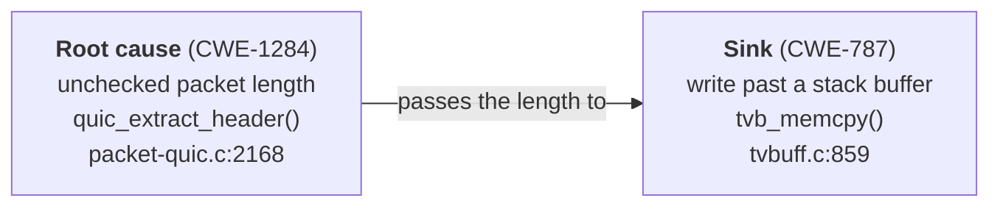

# RootSink

**Reproducible C/C++ crashes: the line that crashed, a candidate for where the bug really is, and the evidence for each.**

[](LICENSE)
[](LICENSE-DATA)
[](pyproject.toml)
[](data/release/dataset.manifest.json)
[](https://doi.org/10.5281/zenodo.24068722)

When a C or C++ program crashes under a memory-error detector (a *sanitizer*), the report points
at the line where memory went wrong. That line is the **sink**. The mistake behind it, the
**root cause**, is often somewhere else: a length nobody checked, a pointer freed too early, a
variable never initialized. A patch that only guards the crashing line makes the crash go away
and leaves the bug in place.

RootSink records both ends and says how it knows each. A record gives the sink, the candidate
root-cause site when one is located, the weakness type ([CWE](https://cwe.mitre.org)) of each, the
evidence behind each one, and, where we ran the crash, the logs and pinned images to run it again.
In this release 2,869 of the 3,341 records locate the sink and 2,333 locate a candidate root; for
1,384 of those, one hunk of the developer's fix, applied alone, stopped the crash there.

---

## Contents

1. [One record, explained](#one-record-explained)
2. [Quick start](#quick-start)
3. [How much to trust a record](#how-much-to-trust-a-record)
4. [Tasks](#tasks)
5. [Scoring a patch](#scoring-a-patch)
6. [Running the crashes](#running-the-crashes)
7. [What is in the repository](#what-is-in-the-repository)
8. [Re-checking our work](#re-checking-our-work)
9. [Splits, duplicates and weights](#splits-duplicates-and-weights)
10. [Limitations](#limitations)
11. [Field reference](#field-reference)
12. [Names, licences and citation](#names-licences-and-citation)

---

## One record, explained

Here is a real record from Wireshark's QUIC parser. A packet carries a one-byte length for its
connection ID, and the parser copied that many bytes into a fixed-size buffer without checking
that they fit.



The sanitizer blames `tvb_memcpy`, a generic copy helper used throughout Wireshark. The real
fix belongs one frame up, in the QUIC parser. RootSink records both, and it records *how it
knows*.

1. **The sink** is reported by AddressSanitizer: a write past the end of a stack buffer, which is
   CWE-787.
2. **The root cause** is a *tested repair site*. We applied each hunk of the developer's fix on its
   own to the vulnerable program, rebuilt it and replayed the crashing input. The three-line hunk in
   `quic_extract_header` alone stopped the crash, and the check it adds bounds a quantity, so a
   rule names CWE-1284.
3. **The reproduction** was checked on both sides. The vulnerable build crashes, the fixed build
   runs the same input cleanly twice, and the developer's fix applied alone removes the crash.

Trimmed, the record looks like this.

```json
{
  "id": "CHAINFORGE-0042476579",
  "project": "wireshark",
  "label_confidence_tier": "gold",
  "chain_string": "CWE-1284->CWE-787",
  "chain": [
    {
      "cwe_id": 1284, "role": "source",
      "site_kind": "tested-repair-site", "evidence_kind": "causally-proven",
      "evidence": {"location": {"file": "epan/dissectors/packet-quic.c", "line": 2168,
                                "function": "quic_extract_header"}}
    },
    {
      "cwe_id": 787, "role": "sink",
      "site_kind": "crash-site", "evidence_kind": "execution",
      "evidence": {"location": {"file": "epan/tvbuff.c", "line": 859, "function": "tvb_memcpy"}}
    }
  ],
  "evidence_floor": "execution",
  "root_site_relation": "on-stack",
  "fix_attribution": {"status": true},
  "commit_range": {"repo": "https://github.com/wireshark/wireshark",
                   "fix_commits": ["ba54b896969930491645aa3ec4125b76480add9c"]},
  "docker_image_ref": {"vulnerable": "n132/arvo:42476579-vul@sha256:…",
                       "patched": "n132/arvo:42476579-fix@sha256:…"},
  "split": "train"
}
```

The logs behind every claim ship with the data. For this record they are the crash report
(`data/evidence/arvo/42476579/vul.sanitizer.txt`), the two clean fixed-side runs (`fix1`, `fix2`)
and the single-hunk test (`data/evidence/ablation/42476579/`).

---

## Quick start

You need Python 3.11 or later and [uv](https://docs.astral.sh/uv/).

```bash
git clone https://github.com/SuryanshSS1011/RootSink && cd RootSink
uv sync --extra dev        # installs the package and its test tools
uv run pytest              # offline tests, a few seconds
```

Load the records and look around. Every record is one line of
[`data/release/dataset.jsonl`](data/release/dataset.jsonl).

```python
import json
from collections import Counter

rows = [json.loads(line) for line in open("data/release/dataset.jsonl")]
print(len(rows), "records")
print(Counter(r["label_confidence_tier"] for r in rows))   # records per tier

# The recommended core: reproduced by us, every instance hunk-named or sanitizer-reported,
# and the developer's fix alone removes the crash.
core = [
    r for r in rows
    if r["label_confidence_tier"] == "gold"
    and r["evidence_floor"] == "execution"
    and r["fix_attribution"]["status"] is True
]
print(len(core), "records in the recommended core")
print(core[0]["id"], core[0]["chain_string"])
```

Every count for this release, from records and projects to tiers, evidence and splits, is in
[`docs/SUPPLEMENT.md`](docs/SUPPLEMENT.md) and
[`data/release/dataset.manifest.json`](data/release/dataset.manifest.json).

---

## How much to trust a record

RootSink keeps two questions apart. **Did the crash reproduce?** is answered by the record's
*tier*. **How well supported is the root cause?** is answered per instance by its *evidence*.
A record can be fully reproduced and still have a weakly supported root cause, and the fields
say so.

### Tiers: did the crash reproduce?

| Tier | Stored as `label_confidence_tier` | Meaning |
|---|---|---|
| **Reproduced** | `gold` | We replayed both versions. The vulnerable build crashes at a sink the sanitizer report locates, the fixed build runs the same input cleanly **twice**, the sink's CWE matches the report, the fix changes real (non-test) code, and any middle step was also sanitizer-reported. |
| **Upstream** | `gold-upstream` | The fix changes real code under a recorded commit and any middle step was sanitizer-reported, but the crash is shown only by the original reporter's logs, not by an archived run of ours. Our kernel attempts reached some of these without completing a two-sided run; `kernel_attempt` gives the outcome of the latest attempt that ran the reproducer, or of the latest attempt if none did (release 1.0.10). |
| **Partial** | `silver` | A run of ours reached it and a criterion fails (from 1.0.10 this includes a fixed kernel that still crashed the same way), or no run reached it and its own material (a dataflow path, a check the fix adds, the reporter's sanitizer report) supports the root CWE. `gold_contract_gaps` names what is missing. |
| **Candidate** | `bronze` | No run of ours reached it, and the root CWE rests only on an advisory's listed CWEs or the catalogue's default root for the sink (rule applied as stated from 1.0.10). |

A run counts as *clean* only if the log shows the input was actually processed. A run that never
started is an infrastructure failure, never evidence that a bug is fixed. The full rules are PR-3
in [`PREREGISTRATION.md`](PREREGISTRATION.md), and
[`src/chainforge/integrity.py`](src/chainforge/integrity.py) enforces them.

The stored values (`gold`, `silver` and so on) keep their original names so that existing code
keeps working. The paper and these docs use the names in the first column.

### Evidence: how is each instance supported?

Every instance in `chain` has an `evidence_kind`, listed here from strongest to weakest.

| `evidence_kind` | Called in the paper | What it means |
|---|---|---|
| `causally-proven` | hunk-named | One hunk of the developer's fix, applied alone and rebuilt, stopped the crash on this input, and a rule named the CWE from the check that hunk adds. The hunk is *sufficient*, not proven to be the only or the best repair. |
| `execution` | sanitizer-reported | A sanitizer report places the instance at a site. A root moved to its tested site in 1.0.7 keeps this kind, because the report still names its CWE; the site the report places is then `evidence.origin_site`. An MSan read of freed memory is CWE-125 at its first use, as an ASan use-after-free read is CWE-125. |
| `attested` | fix-suggested | The fix adds the check the instance lacks, but no run shows the check matters. |
| `dataflow` | dataflow | Only a static code path supports it. |
| `inferred` | inferred | Only a labeling rule supports it. |
| `none` | none | No evidence is declared. The release gate counts these openly rather than hiding them. |

`evidence_floor` is the weakest kind over a record's instances, so filtering on it is the quickest
way to pick records you can lean on.

### Root sites: where does the candidate come from?

`chain[0].site_kind` says what kind of place the root site is.

| `site_kind` | Meaning |
|---|---|
| `tested-repair-site` | A hunk of the fix, applied alone, stopped the crash there. These are the default localization targets. |
| `origin-site` | Where the bad state began, as the sanitizer report itself prints it: the allocation of memory MemorySanitizer later found uninitialized, or the free before a use-after-free. It need not be the defect. Since release 1.0.7 a root whose single-hunk test succeeded is a tested repair site instead, and its origin is kept in `evidence.origin_site`. Since 1.0.8 an origin is never a C++ standard-library frame: it is the first frame of the origin stack in project code or a library built from source. |
| `annotated-site` | A fix pattern, static analysis or labeling rule placed it. |

Sinks and middle steps use `crash-site` (the top project frame of the crash) and `witnessed-site`
(an intermediate step a sanitizer placed). The field is empty when no root site is recorded.

### Where does the root sit relative to the crash?

`root_site_relation` places the root site against the crash: `crash-line`, `crash-function`,
`on-stack` (a caller on the crash's stack), `off-stack` or `file-only`, and it is empty when the
root is not located. A root at the crash line may only guard the symptom, so this field lets you
study, or exclude, those cases.

### The recommended core

For evaluation, start from Reproduced-tier records whose `evidence_floor` is `execution` (every
instance hunk-named or sanitizer-reported) and whose `fix_attribution.status` is `true` (the
developer's fix alone removes the crash). The quick start shows the filter.

---

## Tasks

RootSink defines three tasks. Each one has an *input view* that withholds its answer, and the
tests in [`tests/test_field_policy.py`](tests/test_field_policy.py) check that no input leaks
its target.

| Task | Model input | Target | Scoring |
|---|---|---|---|
| **Localize** the root cause | `localization_view(r)`: the vulnerable image, the crashing input, the sink report, and the sink's CWE and site | `task_target(r, "localize")`: the root site's file, line, function and `site_kind` | Match against the root site. By default, score only tested repair sites (`localization_eligible(r)`), because origin sites are printed in the input's own report. |
| **Label** the chain | `labeling_view(r)`: the repair input plus every instance's site, with no CWE ids | `task_target(r, "label")`: the ordered CWE ids | Compare with the record. |
| **Repair** the bug | `policy_view(r)`: the vulnerable image, the input and the vulnerable-side report | none | Replay with the patch scorer below. |

```python
from chainforge.field_policy import (
    labeling_view, localization_eligible, localization_view, policy_view, task_target,
)

r = core[0]
x, y = localization_view(r), task_target(r, "localize")
if localization_eligible(r):
    ...  # score your model's predicted site against y
```

Pass `with_fix=True` to `localization_view` or `labeling_view` to include the developer's diff,
and report results under that condition separately. `annotation_view(r)` returns everything,
labels included, so use it for reading and auditing, never as a model input.

For a test set newer than a model's training data, `fixed_after(r, "2025-01-01")` keeps records
whose fix is dated after a cutoff. It returns `None` for undated records, so report how many you
excluded.

---

## Scoring a patch

### Bugs from OSS-Fuzz (ARVO)

```bash
# <arvo_id> is the number in the record's "OSS-Fuzz-<id>" alias; <project> is its "project" field
bash infra/repro/score_patch.sh <arvo_id> <project> my.patch out/
bash infra/repro/score_patch.sh <arvo_id> <project> - out/nopatch   # the unmodified build
```

The scorer starts a fresh container of the record's vulnerable image, applies your patch,
rebuilds once and replays the crashing input twice. The verdict is in `out/result.json`.

| Outcome | Meaning |
|---|---|
| `pass` | The patch applied, the build succeeded and every replay ran to completion with no sanitizer report. |
| `crash` | At least one replay crashed. |
| `build_fail` | The patched program did not build. |
| `patch_fail` | A code or build file could not be patched. |
| `not_run` | A replay never reached the input. This is an environment failure, not a negative score, so retry it. |

> [!IMPORTANT]
> A `pass` shows that the program survived this one input. It does **not** show that the root
> cause was fixed or that the program still behaves correctly, and a patch that simply rejects
> the input also passes. For libFuzzer records with a seed corpus, setting `CF_CORPUS=1` and
> `CF_TARGET=<fuzz target>` also records fuzzing coverage, which exposes patches that reject
> inputs early.

> [!WARNING]
> ARVO's vulnerable images keep the project's full git history, and the fix commit is reachable
> in every image we probed. Never give an agent the raw image. Start it with
> `bash infra/repro/agent_env.sh <arvo_id>`, which turns off networking and rewrites every
> repository under `/src` to a single commit holding the vulnerable code.

Resource use per scored episode is in [`docs/RESOURCES.md`](docs/RESOURCES.md).

### Linux kernel bugs (syzbot)

Kernel records are scored the same way, inside a KVM virtual machine.

```bash
export CF_BASE=$HOME/rootsink-kernel      # scratch space for kernel trees and builds
bash infra/cse-kvm/github/kablate_kvm.sh <syzbot extid> <fix sha> my.patch
```

The syzbot extid is the part after `syzbot-` in the record's alias, and the fix sha is in
`commit_range.fix_commits`. The script builds the kernel just before the fix with syzbot's
configuration, checks that the reproducer still triggers syzbot's bug, applies your patch, rebuilds
and boots twice. It needs Linux with `/dev/kvm`, QEMU and Docker, and
[`infra/cse-kvm/github/kablate.yml`](infra/cse-kvm/github/kablate.yml) runs it on GitHub's hosted
runners. An `inconclusive` result is no verdict, never a negative score.

---

## Running the crashes

### Docker images for OSS-Fuzz bugs

Each OSS-Fuzz record runs in two of ARVO's public images, one vulnerable and one fixed. The
crashing input is inside the image at `/tmp/poc`. Since release 1.0.9 the release also keeps a copy
of it, taken from the image the record pins, at the path in `pov_input`
(`data/evidence/arvo/<arvo_id>/poc`; digests and sha256 in `data/evidence/arvo_inputs.jsonl`), so
the inputs outlive the images. `docker_image_ref` pins both images by content digest, so a
retagged image cannot silently change a result.

```bash
docker pull "n132/arvo@sha256:<digest from docker_image_ref>"
```

The images total several terabytes, so they are not part of this repository. Docker Hub limits
anonymous pulls, so log in, or pull through a mirror such as
`mirror.gcr.io/n132/arvo@sha256:…`, which `score_patch.sh` falls back to on its own.
`infra/verify/check_image_digests.py` checks that every pinned digest still resolves without
pulling anything. The images come from ARVO's open-source pipeline
([github.com/n132/arvo](https://github.com/n132/arvo)), which can regenerate one.

### Re-running a single record

Every Reproduced-tier OSS-Fuzz record has a reproduction bundle that pins its image, replays its
input and compares the crash with what the record claims.

```bash
bash infra/repro/verify.sh infra/repro/bundles/CHAINFORGE-0042476579.json
```

### Kernel records

For each Reproduced-tier kernel record, `data/evidence/kernel/<extid>/` holds syzbot's kernel
configuration (`kernel.config`), the C reproducer (`repro.c`), our vulnerable-side KASAN report
(`vul.kasan.txt`), excerpts of the fixed-side boots and the run summary (`differential.json`).
The full boot consoles are in `data/evidence_full/kernel/<extid>/`. No kernel image ships.

```bash
export CF_BASE=$HOME/rootsink-kernel
bash infra/cse-kvm/kdiff_kvm.sh <syzbot extid> <fix sha>
```

`kdiff_kvm.sh` builds the kernel just before the fix and at the fix from the same tree, wraps the
reproducer in a minimal root file system and boots both under KASAN. Expect a full kernel build
(tens of minutes on four cores), an incremental rebuild and up to ten minutes per boot.

---

## What is in the repository

```
data/
  release/
    dataset.jsonl                 the records, one JSON object per line
    corrections_changelog.jsonl   every change to a record, with the rule that made it
    dropped.jsonl                 records removed, and why
    dataset.manifest.json         counts and checksums for this release
    croissant.json                Croissant metadata for ML tooling
    single_weakness.jsonl         records set aside because they hold one weakness, not a chain
  evidence/                       sanitizer reports, single-hunk tests, scorer runs and kernel logs
  evidence_full/kernel/           full kernel boot consoles
  irr/                            the blind label audit: sample, packet, codebook and rater sheets
  validation/                     selections, funnels and validation results
docs/
  SPECIFICATION.md                what a chain is, rules R1 to R10
  DATASHEET.md                    the datasheet, mapping every term to its field
  SUPPLEMENT.md                   the supplementary tables S1 to S5 that the paper cites
  OPEN_ISSUES.md                  known defects and their status
  RESOURCES.md                    time, memory and disk per scored episode
PREREGISTRATION.md                the rule log: every labeling rule, with dated amendments
src/chainforge/                   schema, evidence kinds, the Reproduced-tier contract, task views
infra/repro/                      patch scorer, agent environment, reproduction bundles
infra/cse-kvm/                    kernel replay and scoring in KVM
infra/verify/                     the pipelines that attach evidence, plus the release gate
infra/paper/                      count checks, and generators for the supplement and Croissant
tests/                            offline unit tests
```

---

## Re-checking our work

Everything we report can be recomputed from this repository.

```bash
uv run python infra/verify/conformance.py        # re-checks every record against the tier rules
uv run python infra/paper/reconcile_counts.py    # every population, unit and their relations
uv run python infra/verify/score_audit.py        # the blind audit's precision and agreement
uv run python infra/verify/score_ai_raters.py    # the exploratory language-model comparison
bash infra/verify/rebuild_derived.sh             # regenerates every derived file, then the gate
```

The audit scripts write their results to `paper_artifacts/`, which git ignores.
`rebuild_derived.sh` rewrites the derived files in place, offline, so a clean `git status`
afterwards shows they match the release.

**The label audit.** Two raters who did not build the dataset judged a sample of records, blind
to our labels. `data/irr/` holds the sampled records with the labels they were scored against
(`sample.json`), exactly what the raters saw (`packet.md`), both returned sheets with each rater's
stated background (`returned/`) and the language models' sheets from an exploratory comparison
(`ai/`).

**Rules and corrections.** Every labeling rule is in [`PREREGISTRATION.md`](PREREGISTRATION.md),
with dated amendments. Its dates are self-reported, and from 2026-10-19 on each rule was written
before its outcomes were seen unless its entry says otherwise. Every change to a record is in
`corrections_changelog.jsonl` with the id of the rule that made it, and every removed record is
in `dropped.jsonl` with the reason.

---

## Splits, duplicates and weights

1. **Splits.** `split` assigns each record to `train`, `validation` or `test`. Each project
   stays in one split, and kernel records are split by subsystem (`linux-kernel/<subsystem>`),
   apart from a catch-all of advisory-only kernel races. Units are assigned whole, largest first,
   to the split furthest below a 70/15/15 target, and records that share a fix commit always land
   together.
2. **Duplicates.** OSS-Fuzz often closes several crash reports with one fix. Those records are
   kept, because each is a distinct reproduction, but they share a `duplicate_group` named after
   the project and the fix commit. Count groups when you want bugs rather than inputs.
3. **Weights.** `sampling_weight` evens out large projects and duplicate groups. It is
   `1 / (inputs in the duplicate group × √(bugs in the project))`, rescaled to a mean of 1 within
   each tier and split.

---

## Limitations

RootSink is careful about what it claims, and so should its users be.

1. **Root sites are candidates.** A tested repair site is a place where a fix *suffices* for one
   input. It is not proven to be the defect, the only repair or the best one.
2. **Origin sites are rarely the defect.** They mark where bad state began, and the blind audit
   agreed with them far less often than with tested repair sites.
3. **CWE order is by rule.** The order of CWEs follows our catalogue of admissible pairs, built
   from MITRE's CWE relations, not an observed sequence of events.
4. **Fuzzer bias.** Most Reproduced-tier records come from OSS-Fuzz, so they inherit its bias
   toward bugs that fuzzers find.
5. **External images.** ARVO's images are pinned by digest but hosted on a personal Docker Hub
   account that is not archived. Our own rebuild from the projects' source, without ARVO's
   images, succeeded at both revisions for 13 of 60 sampled records (PR-15), so the images are a
   real dependency.
6. **The audit is small.** Both raters are co-authors and graduate students, not security
   specialists, which is why their sheets are released for anyone to re-check.

Known defects and their status are tracked in [`docs/OPEN_ISSUES.md`](docs/OPEN_ISSUES.md).

---

## Field reference

<details>
<summary><b>The fields you will use most</b> (click to expand)</summary>

<br/>

| Field | What it holds |
|---|---|
| `id` | A stable record id (`CHAINFORGE-…`). |
| `project`, `aliases` | The project, and ids such as `OSS-Fuzz-<id>` or `syzbot-<extid>`. |
| `label_confidence_tier` | The tier (see [Tiers](#tiers-did-the-crash-reproduce)). |
| `gold_contract_gaps` | For records below the Reproduced tier, which criteria failed and why. |
| `kernel_attempt` | For syzbot records, the outcome of our kernel differential attempts (`status`, `detail`, both commits, number of attempts): the latest attempt that ran the reproducer, or the latest attempt if none did. A `vul_no_repro` whose detail ends `(no_boot)` ran nothing. Only a `differential` attempt's logs are archived, as the record's own `sanitizer_reports` (release 1.0.10). |
| `chain` | The CWE instances in order, root first and sink last. |
| `chain[i].cwe_id`, `role` | The CWE number, and `source`, `intermediate` or `sink`. |
| `chain[i].evidence_kind` | How the instance is supported (see [Evidence](#evidence-how-is-each-instance-supported)). |
| `chain[i].site_kind` | What kind of site it is (see [Root sites](#root-sites-where-does-the-candidate-come-from)). |
| `chain[i].evidence.location` | The site's `file`, `line` and `function`, when known. |
| `chain[i].cwe_basis` | The strongest input the CWE rule had, such as `guard-class`, `msan-origin`, `sanitizer-class` or `advisory`. |
| `chain[i].cwe_class`, `cwe_mapping` | The original broad label, and how it was refined. A `CWE-20` root becomes `CWE-1284` (`quantity`) or `CWE-1285` (`index`), and stays `CWE-20` (`class-level`) when neither fits. |
| `chain_string` | The chain in one line, such as `CWE-1284->CWE-787`. |
| `chain_kind` | `stage-decomposition` when consecutive CWEs describe one faulting operation, `multi-weakness` otherwise. |
| `evidence_floor` | The weakest evidence kind in the record. |
| `mitre_chain.edges` | Each CWE pair's status in MITRE's catalogue (direct, inherited and so on). This is catalogue support, not observed evidence. |
| `root_site_relation` | Where the root site lies relative to the crash. |
| `fix_attribution.status` | `true` when the developer's fix alone removes the crash. |
| `commit_range` | The fix repository, `fix_commits`, and the source's own form in `fixed`. |
| `patch_diff` | The developer's fix. |
| `docker_image_ref` | The vulnerable and fixed images, pinned by digest (OSS-Fuzz records). |
| `pov_input` | The crashing input or kernel reproducer as a file in the release. OSS-Fuzz inputs are copies of each pinned image's `/tmp/poc` (release 1.0.9). |
| `sanitizer_reports` | Every run's report, with its revision and log path. |
| `split`, `duplicate_group`, `sampling_weight` | See [Splits, duplicates and weights](#splits-duplicates-and-weights). |
| `fix_date`, `license` | The fix's date, and the project's licence where known. |

Every field, and every term the paper uses, is mapped in [`docs/DATASHEET.md`](docs/DATASHEET.md).
What makes a valid chain is defined in [`docs/SPECIFICATION.md`](docs/SPECIFICATION.md).

</details>

---

## Names, licences and citation

**Why "chainforge"?** RootSink was built under the working name ChainForge. The Python package
(`chainforge`) and the record ids (`CHAINFORGE-…`) keep that name so that ids stay stable across
releases.

**Licences.** The code is MIT ([`LICENSE`](LICENSE)). The labels, chains and annotations are
CC BY 4.0 ([`LICENSE-DATA`](LICENSE-DATA)). Logs and diffs come from each project's own fuzz
targets and history and stay under that project's licence, which each record names in `license`.
The crashing inputs (`data/evidence/arvo/<id>/poc`) are OSS-Fuzz test cases copied unchanged from
ARVO's public images. They are not covered by CC BY 4.0, and an input derived from a project's own
files stays under that project's licence. Every Reproduced-tier bug is already fixed and public, and the only personal data are developer
names and e-mail addresses that the projects themselves publish.

**Citation.** Please cite RootSink using [`CITATION.cff`](CITATION.cff), or GitHub's
"Cite this repository" button. Every release is archived on Zenodo under
[doi:10.5281/zenodo.24068722](https://doi.org/10.5281/zenodo.24068722), which resolves to the
newest version; each version also has its own DOI there.

**Questions and problems.** Please open an issue on GitHub.
